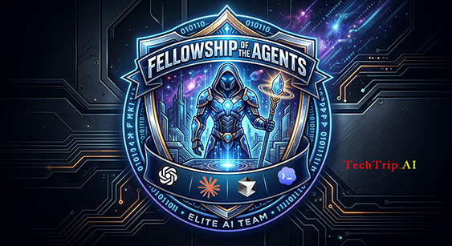

# techtrip-secondbrain

<p align="center">
  
</p>

**This Plugin is a one-command bootstrapper designed to install, scaffold and implement a generic, out-of-the-box LLM Wiki "second brain" on a
fresh Mac or Linux machine.** It installs Obsidian and a select set of community plugins, pulls the
[**`claude-obsidian`**](https://github.com/AgriciDaniel/claude-obsidian) plugin — by
[**AgriciDaniel**](https://github.com/AgriciDaniel), MIT — from a **lightly-patched fork
TechTrip maintains** ([`TechTripAi/claude-obsidian`](https://github.com/TechTripAi/claude-obsidian),
bug fixes plus maintenance skills and deterministic lint), scaffolds a clean vault, wires the Obsidian MCP server, ships the `yt-fetch`,
`x-fetch`, `voice-fetch`, `code-fetch`, and `notebooklm-ingest` source skills plus the `new-idea` origination
scaffolder, and sets up git sync + backup — all interactive and idempotent.

## What is a "second brain"?

A second brain is a folder of notes that an AI keeps organized for you.

You drop things in: an article, a YouTube video, a voice memo, a codebase, a conversation.
The AI reads each one and writes what it learned into a set of short, linked notes, in
plain Markdown files you can open in Obsidian or any text editor. When you ask a question,
it answers from those notes and cites them. When something new contradicts or updates an
older note, it fixes the note. Over months, the folder becomes a reliable record of what
you know, written in your words and organized the way you think.

The idea comes from Andrej Karpathy's
[**LLM Wiki**](https://gist.github.com/karpathy/442a6bf555914893e9891c11519de94f). His
point: people have always tried to keep personal knowledge bases, and they always die,
because keeping one tidy takes more effort than it gives back. An AI does not get bored.
It does the filing, the cross-linking, and the cleanup. You decide what goes in and what
questions to ask.

It works in three moves:

- **Ingest.** Give it a source. It reads the source, updates a handful of notes, and
  records where the information came from.
- **Query.** Ask a question. It answers from your notes, and if the answer is worth
  keeping, it files that too.
- **Lint.** Every so often, it checks the whole folder for dead links, orphaned notes,
  contradictions, and notes that have gone stale.

Three things make it up: the **raw sources** you keep (never changed), the **wiki** of
notes the AI writes, and a small set of **rules** for how notes are named, tagged, and
linked. `claude-obsidian` implements this in Obsidian. `techtrip-secondbrain` installs
and configures the whole thing on your Mac in one go.

## Requirements

- **macOS** (MVP is macOS-only; Windows/Linux deferred).
- **Claude Code** already installed — the plugin marketplace is how both plugins
  get onto the machine (a Claude plugin can't install Claude itself). After
  setup, you can drive the vault from Claude Code **or** other harnesses; see
  [Use with any harness](docs/harnesses.md).
- **Homebrew** — the bootstrapper installs the rest, but if brew is missing it prints
  the official one-liner for you to run once.

## Installation

Install it like any Claude Code plugin, from TechTrip AI's catalog
[TechTrip-AI-plugins](https://github.com/TechTripAi/TechTrip-AI-plugins), which lists
everything TechTrip releases so you add one marketplace and install what you need:

```
claude plugin marketplace add TechTripAi/TechTrip-AI-plugins
claude plugin install techtrip-secondbrain@TechTrip-AI-plugins
```

> Installed before 0.2.21 from this repository's own marketplace
> (`techtrip-secondbrain@techtrip-secondbrain`)? That marketplace is retired. Run
> `claude plugin marketplace remove techtrip-secondbrain`, then the two commands above,
> then `/secondbrain` to migrate claude-obsidian to the catalog as well.

Then, in Claude Code:

```
/secondbrain
```

…and follow the interactive workflow. Or run the scripts directly from a git clone; see [How it works](docs/how-it-works.md#running-it-manually-on-the-command-line-git-clone-only).

> **TechTrip Second Brain is an orchestrator.** It installs the
> [`claude-obsidian`](https://github.com/AgriciDaniel/claude-obsidian) LLM Wiki runtime
> ([AgriciDaniel](https://github.com/AgriciDaniel), MIT) at setup time — from a
> **lightly-patched fork we maintain** ([TechTripAi/claude-obsidian](https://github.com/TechTripAi/claude-obsidian))
> that carries bug fixes upstream is backlogged on, plus maintenance skills and a
> deterministic lint engine upstream does not ship in this form (see the fork's
> CHANGELOG). It fills only the OS-level
> and sync gaps the plugin leaves to you — nothing of his is copied into this repo. The
> MVP produces a **generic empty scaffold** (no personal content) that you grow yourself.
> Credits: [ATTRIBUTION.md](ATTRIBUTION.md).

## Features

`techtrip-secondbrain` does exactly five things — it makes `claude-obsidian` easy to
install and use, with some added functionality:

1. **Automates installation** of `claude-obsidian` and everything around it
   (Obsidian, community plugins, dependencies, MCP wiring, sync).
2. **Prechecks and post-checks** — `precheck` audits the machine before setup, and
   `doctor`/`repair-mcp` diagnose and fix anything broken after.
3. **Adds five ingest options** claude-obsidian doesn't ship: `yt-fetch` (YouTube
   transcripts), `x-fetch` (X/Twitter posts, with on-device transcripts for video
   posts), `voice-fetch` (on-device audio transcription), `code-fetch`
   (codebases read by the agent into one semantic digest — architecture, API
   contracts, purpose), and `notebooklm-ingest` (NotebookLM synthesis).
4. **Adds origination** — `/new-idea` scaffolds a greenfield project
   (thesis → decisions → spec) for the ideas *you* originate, the generative
   front-half that graduates back into the ingest pipeline.
5. **Teaches you the wiki** — `/brain-dump`, a guided tutorial that walks a new user
   through every ingestion type, topic research with `/autoresearch`, starting a
   new idea, the six wiki modes and `/mode-fit`, and the maintenance workflow.

## What this plugin adds on top of claude-obsidian

`claude-obsidian` supplies the wiki runtime. These ten skills ship only with
`techtrip-secondbrain` and are the reason to install it rather than the runtime alone.

**Originate your own ideas**

- **`new-idea`** — the generative front half of the pipeline. Where ingestion files what
  *others* wrote, `/new-idea` scaffolds a project for an idea *you* originate:
  `wiki/projects/<slug>/` with a tracker, a thesis workbench, open questions, an
  append-only decisions log and a spec, then walks the loop Frame → Mull → Decide →
  Reconcile → Log → Graduate until the idea hardens into wiki concepts. Try “start a new
  idea for an AI support product.”

**Bring in sources claude-obsidian cannot read**

- **`yt-fetch`** — a YouTube watch page holds none of the spoken content, so a plain URL
  ingest misses the video entirely. `yt-fetch` pulls the transcript and metadata with
  `yt-dlp`, lands an ingest-ready source in `.raw/videos/`, and hands off to the wiki.
  Try “add this YouTube video to my wiki.”
- **`x-fetch`** — fetches an X (Twitter) post's text and metadata, and when the post
  carries video, transcribes it on-device with WhisperKit so the spoken content lands in
  the wiki too. Nothing leaves the machine. Try “ingest this tweet.”
- **`voice-fetch`** — transcribes voice memos and local audio on-device, then ingests.
- **`code-fetch`** — the agent reads a local or remote codebase and writes one semantic
  digest (purpose, architecture, API surface), never a file-by-file dump.
- **`notebooklm-ingest`** — synthesize many sources through NotebookLM, or pull a
  notebook you already curated, into one wiki entry.

**Learn it without reading a manual**

- **`brain-dump`** — the plugin comes packaged with its own teacher. `/brain-dump` is a
  menu-style tour that explains every ingestion type (files, URLs, YouTube, X, voice
  memos, codebases, NotebookLM), topic research with `/autoresearch`, starting an idea
  with `/new-idea`, the hot cache and `.raw/`, the six wiki modes, maintenance, and how
  to turn optional features on or off. For each one it hands you the exact prompt to
  type. It teaches and never changes your vault, so run it on day one and again
  whenever you forget how something works.

**Install and verify the stack**

- **`secondbrain`** — the one-command interactive setup. **`secondbrain-doctor`** —
  health check and MCP repair. **`mode-fit`** — checks the wiki mode fits how you work.

## Skills at a glance

| Group | Skills |
|-------|--------|
| Bring knowledge in | `wiki-ingest`, `defuddle`, `yt-fetch` ★, `x-fetch` ★, `voice-fetch` ★, `code-fetch` ★, `notebooklm-ingest` ★, `autoresearch`, `save` |
| Use and develop what you know | `wiki-query`, `wiki-retrieve`, `think`, `new-idea` ★, `canvas`, `obsidian-bases`, `wiki-mode` |
| Maintain the knowledge base | `wiki-lint`, `wiki-archive`, `wiki-delete`, `wiki-fold`, `wiki-cli`, `obsidian-markdown` |
| Set up and learn the system | `wiki`, `secondbrain` ★, `secondbrain-doctor` ★, `mode-fit` ★, `brain-dump` ★ |

★ ships with this plugin; the rest come from `claude-obsidian`. Each one is described, with an example prompt, in [docs/skills.md](docs/skills.md).
New here? Run `/brain-dump` and let the plugin teach you.

## Documentation

- [How it works](docs/how-it-works.md): what gets installed, why Obsidian, and the setup scripts behind `/secondbrain`.
- [Skills](docs/skills.md): every skill with an example prompt.
- [Use with any harness](docs/harnesses.md): Claude Code installs it; Cursor, Copilot CLI, Codex and others drive it.
- [After setup](docs/after-setup.md): manual follow-ups and optional features (YouTube, voice, NotebookLM).
- [Updating](docs/updating.md): marketplace and git-clone update paths, plus release and upgrade notes.
- [Sync and second machines](docs/sync.md): the git sync model and adding another Mac.
- [Safety, limitations and scope](docs/safety.md): guardrails to set before running any AI against your vault, the single-tenant trust model, and what is out of scope.
- [CHANGELOG](CHANGELOG.md) and [ATTRIBUTION](ATTRIBUTION.md).

> [!IMPORTANT]
> This plugin has Claude read and write files on your machine, and its hooks run in every Claude session once installed. Read [Safety, limitations and scope](docs/safety.md) before running `/secondbrain` against a real vault.

## Questions / issues

Open an issue at
[TechTripAi/techtrip-secondbrain](https://github.com/TechTripAi/techtrip-secondbrain/issues),
or reach out directly: **terry.trippany@techtrip.ai**.

## Credits

Wiki runtime: **[`claude-obsidian`](https://github.com/AgriciDaniel/claude-obsidian)**
by **[AgriciDaniel](https://github.com/AgriciDaniel)** (MIT). Community plugins and the
Karpathy LLM-Wiki pattern are credited in [ATTRIBUTION.md](ATTRIBUTION.md).

## License

**FSL-1.1-MIT** (Functional Source License) © 2026 Terry Trippany (Try AI Solutions).
See [LICENSE.md](LICENSE.md). Source-available with a Competing-Use restriction that
**automatically converts to MIT two years after each release**. Internal use,
non-commercial education/research, and professional services for licensees are
permitted; reselling a substantially similar product is not (until the MIT conversion).
